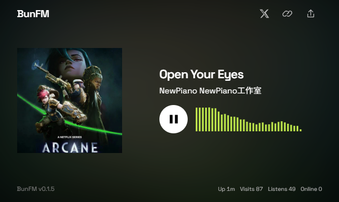

# BunFM

A self-hosted radio station. One continuous broadcast, a minimal web player,
and optional Telegram controls and AI host transitions.



## Features

- **Live radio** — FFmpeg turns your audio directory into a shared MP3 broadcast.
- **Web player** — responsive layout, track metadata, embedded artwork,
  cover-colored backgrounds and a real-time audio spectrum.
- **Installable PWA** — desktop and home-screen playback, with an offline page
  shell. Live audio still requires a connection.
- **Telegram bot** — upload audio or voice messages, list tracks, skip, mute
  and delete files.
- **AI host** — optional spoken transitions with music ducking and a smooth
  return to full volume. Playback continues normally if preparation fails.
- **Station stats** — uptime, persistent visit/listen totals and active stream
  connections. No database required.

## Quick start

Requires **Node.js 20+** and **FFmpeg / ffprobe** on `PATH`. Bun and a Telegram
bot token are not required for the radio stream.

```sh
git clone https://github.com/StackStoreHQ/bun-fm.git
cd bun-fm
npm install
```

Copy [`config.example.yaml`](config.example.yaml) to `config.yaml` (required),
then put audio files in `media/`. The directory is the playlist.
BunFM exits on startup when `config.yaml` is missing.

Run `npm run doctor` to test connectivity for configured LLM, TTS, and Telegram
services. Unconfigured services are skipped. LLM and TTS checks make real API
requests, so providers may charge for them; failures return a non-zero exit code.

```sh
npm run build
node dist/index.js
```

Run commands from the project root. Open **http://127.0.0.1:7080/** and press
play to join the broadcast. Pausing disconnects; playing again joins what is
on air, rather than resuming an old position.

For an external player, use **http://127.0.0.1:7080/stream**:

```sh
ffplay http://127.0.0.1:7080/stream
```

## Configuration

Settings are loaded from `config.yaml` at startup; restart after editing.
Keep this file private. See the [commented example](config.example.yaml) for
all options and defaults.

| Section | What it controls |
| --- | --- |
| `server` | Bind address, port, public URL and connection buffer |
| `site` | Station title, description, fallback cover and spectrum |
| `storage` | Audio/temp directories and optional deletion after playback |
| `playback` | Random playback, or directory order with `random: false` |
| `telegram` | Optional bot token |
| `transition` | Enable AI hosting; speech/music timing, gain, fade and prompt |
| `llm` / `tts` | OpenAI-compatible provider URLs, models and credentials |

For custom artwork, add an image to `public/` and set `site.defaultCover`
to its URL, such as `/cover.jpg`.

**AI host:** set `transition.enabled: true` and configure both `llm` and `tts`,
including their API keys. Providers must support `/chat/completions` and
`/audio/speech`. Prompts use `{A}` and `{B}` for track names. Track names and
speech text are sent to the providers, which may charge for requests.

## Telegram

Create a bot with [@BotFather](https://t.me/BotFather), set
`telegram.botToken`, and restart. Send audio files or voice messages to add
tracks; duplicate filenames are rejected.

| Command | Action |
| --- | --- |
| `/start` | Show station information |
| `/ls` | List tracks with their numbers |
| `/rm <number>` | Delete a track, e.g. `/rm 3` |
| `/mute` | Toggle broadcast mute |
| `/next` | Skip the current track |

Bot commands have no user allowlist; keep access to your bot trusted.

## Deployment & development

- The default bind address is `127.0.0.1`. For remote access, configure
  `server.host` or put a reverse proxy in front of the service.
- Use **HTTPS** for PWA installation and the audio spectrum; localhost also
  works. Offline support caches the player shell, not the live broadcast.
- Proxy `/stream` without response buffering and allow long-lived connections.
  Keep `/api/*` and the root-level player/PWA assets reachable.
- Visit/listen totals persist in `data/stats.json`; preserve it across deploys.
  “Online” counts stream connections, not unique people.
- `npm run dev` starts watch mode; `npm run start-ts` runs TypeScript directly.
  `npm run build` compiles to `dist/`; `npx tsc --noEmit` checks types.
- `npm start` uses POSIX environment syntax. On Windows, use
  `node dist/index.js` after building instead.

## License

[MIT](LICENSE)
